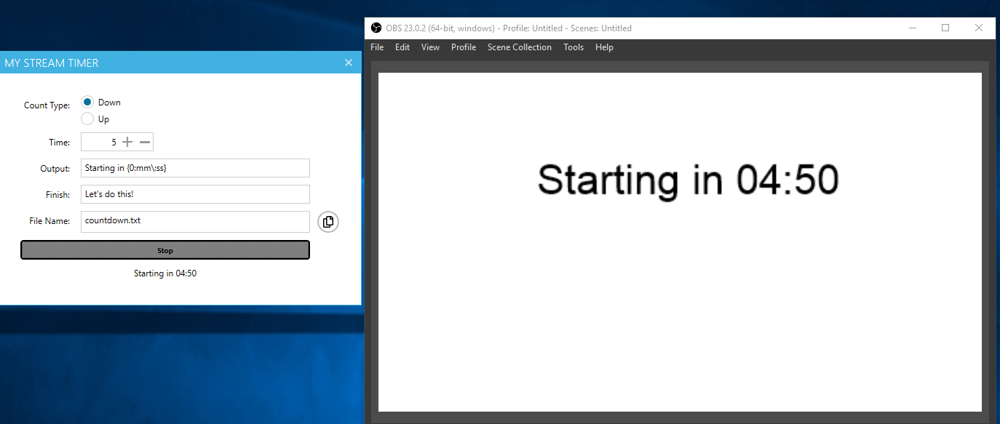
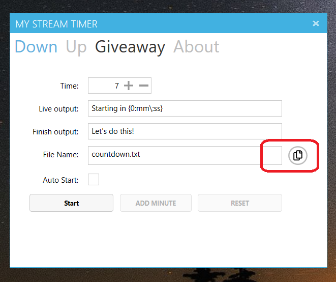
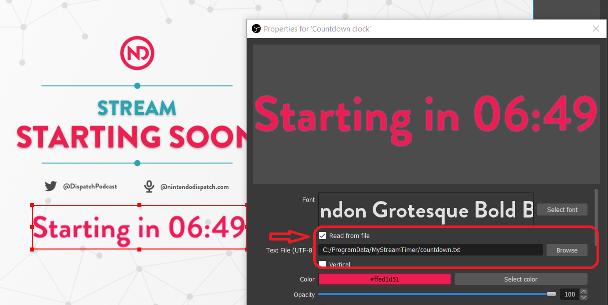
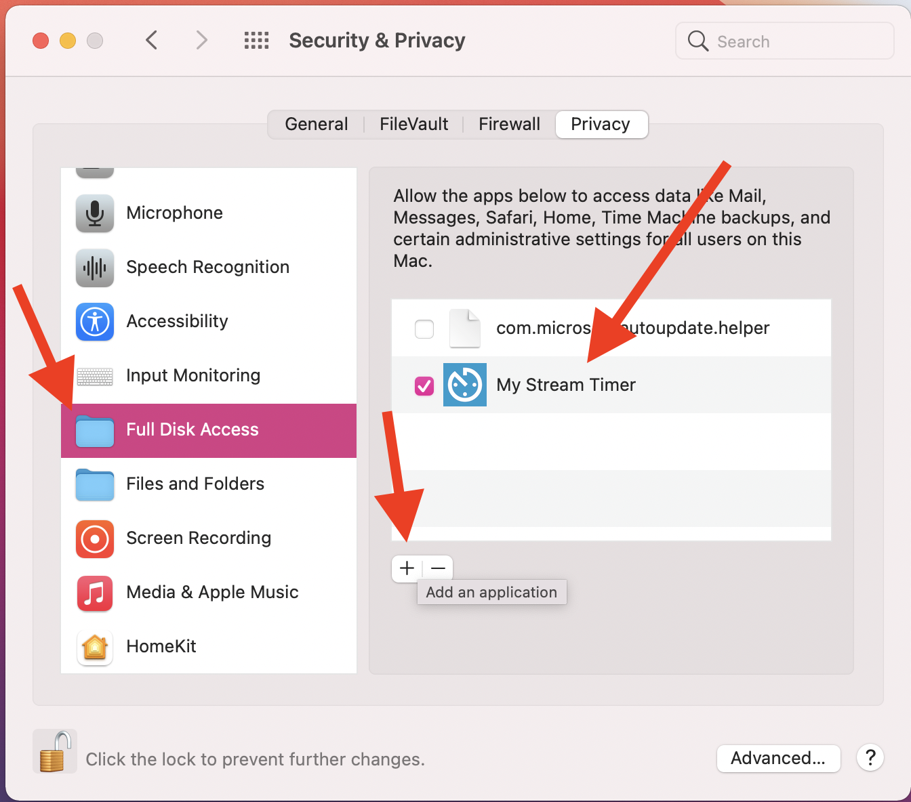

# My Stream Timer
My Stream Timer is an easy to use countdown and count-up timer for streamers. Multiple timers are available that write a file to disk to use with OBS, SLOBS, or your favorite streaming application. Have it auto start so it works with Stream Deck!


Download today on Windows or macOS:
* Windows 10 (1809+) / Windows 11 via the [Microsoft Store](https://www.microsoft.com/p/my-stream-timer/9n5nxx3wk7k7?WT.mc_id=friends-0000-jamont)
* macOS via the [App Store](https://itunes.apple.com/us/app/my-stream-timer/id1460539461?mt=12)



The Windows app is distributed exclusively through the Microsoft Store (Pro features use Store licensing). A `vX.Y.Z-windows` tag starts the [Windows Store Publish](.github/workflows/windows-store-publish.yml) workflow, which submits the release to a configured **tester package flight** after protected-environment approval. Public release is a separate manual step after testing; tags never submit directly to production.

## What's new in 3.0 (Windows)

My Stream Timer for Windows was rewritten from the ground up in **WinUI 3 / Windows App SDK** with a modern Fluent design. Everything you had configured before — timer settings, file names, output folder and Pro unlocks — carries over automatically.

* Sidebar navigation, Mica, Light/Dark/System themes
* **Rename timers and pick an icon** for each one (Settings › Timers)
* **Pop‑out timer windows** (Pro) with custom font, size and colours — great on a second monitor or pinned over OBS
* **Automation page** with a command builder that generates `mystreamtimer://` URLs for Stream Deck and scripts
* Output folder management (choose, test access, open in Explorer), per‑timer **+1 / −1 minute**, keyboard shortcuts (Space start/stop, P pause, R reset, Ctrl+Shift+1…7 switch timers)
* Pro **subscriptions** (monthly / 6 months) in addition to the lifetime tiers
* New automation host: `mystreamtimer://time/?start` and `?stop` for the clock timer
* Keeps your PC awake while a timer is running — no more "do not minimize" warning

## Integrating into OBS/SLOBS

Open My Stream Timer and tap the copy icon to copy the location on disk where My Stream Timer saves output files.



Next, Open OBS/SLOBS and add a **Text** source. Check "Read from file" and click browse and navigate location that was copied to the clipboard. Select on of the text files for count down, up, or giveaway. That's it! When you start the countdown it will show up!



If you are on macOS when you set click "Browse" in OBS/SLOBS the file picker will come up. To browse to a folder use the following command on your keyboard: (CMD + SHIFT + G) and then paste the directory from My Stream Timer

## End sounds

Every countdown and count-up timer has its own sound settings on its timer page, so each timer can use a different sound. Choose **Default beep**, **Chime**, **Bell**, **Digital**, or **Custom**, and use **Preview** to hear it. The four built-in sounds are original synthesized WAV files included with each app; Default beep uses the classic three-beep pattern.

- **Countdowns:** turn on **Beep at zero** to play the timer's sound when it finishes.
- **Count ups:** turn on **Play sound at time** and set the minutes and seconds. The sound plays once when the count up reaches that time, and the timer keeps counting. Resuming a paused count up that is already past the time does not replay the sound.

For **Custom**, choose an MP3 or WAV file (`.mp3`, `.wav`, or `.wave`) for that timer. The selection is saved between app launches. Keep the file available in its selected location; if it cannot be played, the app falls back to Default beep.

## Menu bar timers (macOS, Pro)

On macOS, any timer can have its own menu bar item. Turn on **Show in menu bar** on a timer's page, or pick several at once under **Settings › Menu bar timers**.

- An idle timer shows its icon. A running timer shows the icon and the timer's output, in the format you set for it, so it matches the timer's output file. A paused timer shows a pause icon with the output it stopped at. Output longer than 32 characters is cut off with an ellipsis.
- Click the item to start, stop, pause, resume, add a minute, reset, open the app on that timer, or hide the item.
- While at least one timer is in the menu bar, My Stream Timer keeps running after you close its window, and timers keep writing their output files. Use **Quit My Stream Timer** in the menu to quit.

## Integrating into Stream Deck

The official My Stream Timer plugin is in [`MyStreamTimer.StreamDeck`](MyStreamTimer.StreamDeck). It provides configurable actions for every countdown, count-up, and Current Time output, including start, add/subtract, pause, resume, reset, and stop. A Start Timer action can also run an independent countdown that writes directly to a text file without launching the app.

Plugin releases are attached to GitHub tags such as `v2.0.0-streamdeck`. Existing buttons from the legacy plugin must be removed and re-added because version 2 uses new plugin and action identifiers.

You can also integrate a **Website** command under **System** using a protocol URL:

* Count down from X minutes: mystreamtimer://countdown/?mins=6
* Count down to specific time (24 hour clock): mystreamtimer://countdown/?to=15:30
* Count down to top of the hour: mystreamtimer://countdown/?topofhour

## Integrating into Command Line

My Stream Timer uses standard protocals to work via the command line. For example you can call the following on the Windows command line:

```
start mystreamtimer://countdown/?mins=6
```

Here are the list of commands:
* mystreamtimer://countdown/?mins=6
* mystreamtimer://countdown/?secs=90
* mystreamtimer://countdown/?topofhour
* mystreamtimer://countdown/?to=15:30
* mystreamtimer://countdown/?addmins=1 · ?addsecs=30 · ?subtractmins=1 · ?subtractsecs=30
* mystreamtimer://countdown/?pause · ?resume · ?reset · ?stop
* mystreamtimer://time/?start · ?stop (clock timer, Pro)

**countdown** can be replaced with: **countdown2**, **countdown3**, **countdown4**, **countup**, **countup2** depending on which one you would like to control. The Automation page in the app builds these URLs for you.

## Integrating into Deckboard (using an Extension App for Windows)
If you do not own a Stream Deck but use other apps to control your stream, [Dara Oladapo](https://twitter.com/daraoladapo) created an extension app for Windows that he uses for Deckboard. You can check out the project [here](https://github.com/DaraOladapo/stream-deckboard) and web link [here](https://daraoladapo.github.io/stream-deckboard/).

## In Action

View the walkthrough on [YouTube](https://youtu.be/j_GdGIdDRxI)

## Building from source (Windows)

Requires the .NET 10 SDK, the [WinApp CLI](https://aka.ms/winapp) and Developer Mode.

```
dotnet test tests\MyStreamTimer.Core.Tests
dotnet build src\MyStreamTimer.WinUI\MyStreamTimer.WinUI.csproj -p:Platform=x64
cd src\MyStreamTimer.WinUI && dotnet run
```

Debug builds install side‑by‑side with the Store app under a `*.Dev` identity (protocol `mystreamtimer-dev://`). Release builds use the Store identity. The migration plan, design spec and upgrade‑test checklist live in `winui-migration/`.

## Troubleshooting

My Stream Timer should work out of the box, but if it doesn't here are some tips and tricks.

### Windows: Crashes or the app will not open

If the app opens, go to **About > Diagnostics > Save diagnostics report**. Choose a local ZIP file, review it, and share it privately with support. Nothing is uploaded automatically. The report contains bounded startup/failure records, exception types, HRESULTs, stacks, and app/OS/runtime versions. It excludes exception messages, timer content, output files, settings databases, and account/licensing information. Historical plain-text crash logs are not included automatically because they can contain private paths or text.

**Open crash logs folder** also opens the local diagnostics directory. If the app cannot open, paste this path into Explorer:

```text
%LOCALAPPDATA%\Packages\23875RefractoredLLC.MyStreamTimer_jcspp7mzn01xr\LocalState\logs
```

Older 3.0/3.1 builds may have `crash-*.txt` files there. New builds retain at most six structured diagnostic files of up to 128 KiB each, including a per-process session ID. Review any older logs before sharing them. **Do not uninstall or reset the app to collect logs**; doing so can remove settings and evidence.

Invalid timer commands and unavailable diagnostic reports are reported without deliberately throwing. Recoverable export failures show an error instead of claiming a report was saved. If an exception reaches the managed entry point, the app records it, shows an error, and exits with a failure code rather than rethrowing. This does not make native fail-fast or other fatal framework failures recoverable, and the app does not mark all unhandled XAML exceptions as safe to ignore. Do not deliberately crash a live app to test diagnostics.

Failures before the .NET runtime starts and native fail-fast crashes may leave no application log. In **Reliability Monitor** or **Event Viewer > Windows Logs > Application**, look for MyStreamTimer.exe at the failure time. Useful details include the faulting module, exception code, app version, and full Windows build/revision. Relevant events commonly include Application Error **1000**, .NET Runtime **1026**, and Windows Error Reporting **1001**. Startup-only failures can also require the AppModel-Runtime and AppXDeploymentServer event channels. Share only app-specific entries, not an export of all machine events.

Build `10.0.26200` is **Windows 11 25H2**, not Windows 10. Include the complete revision, such as `26200.x`, when reporting a failure.

#### Optional: capture a crash dump on a test machine

Only enable this when support needs native/early crash evidence. Dumps can contain private process memory; do not post them to public GitHub issues. The following **administrator PowerShell** commands enable full dumps for this executable only, not for every application:

```powershell
$key = 'HKLM:\SOFTWARE\Microsoft\Windows\Windows Error Reporting\LocalDumps\MyStreamTimer.exe'
if (Test-Path -LiteralPath $key) {
    throw 'Existing per-app dump settings found. Preserve them before changing anything.'
}
New-Item -Path $key -Force | Out-Null
New-ItemProperty -Path $key -Name DumpType -PropertyType DWord -Value 2 | Out-Null
New-ItemProperty -Path $key -Name DumpCount -PropertyType DWord -Value 3 | Out-Null
```

Reproduce the problem with consent on the test machine, then check `%LOCALAPPDATA%\CrashDumps`. Missing-runtime exits are not necessarily crashes, so they might not create a dump. Automatic debugger settings can also prevent WER LocalDumps collection. For opaque WinUI errors, analyze native/stowed exceptions with WinDbg or use the WinApp CLI's attached `--debug-output` diagnostics; an app log alone cannot decode native fail-fast failures.

After collection, remove **only the per-app key created above** to restore the previous configuration:

```powershell
Remove-Item -LiteralPath 'HKLM:\SOFTWARE\Microsoft\Windows\Windows Error Reporting\LocalDumps\MyStreamTimer.exe'
```

See [Microsoft's LocalDumps guidance](https://learn.microsoft.com/windows/win32/wer/collecting-user-mode-dumps) for collection limitations.

### Windows: flight-first releases

Configure the flight once before publishing a new Windows tag:

1. In Partner Center, open My Stream Timer's **Package flights** and create a flight linked to the **IAP Test** known user group, or use an existing flight linked to that group. The group selects the testers; its name is **not** the package flight ID.
2. Obtain that package flight's ID. With the Store CLI authenticated for this app, `msstore flights list 9N5NXX3WK7K7` lists the flights and their IDs. Do not use a group ID, group name, or flight display name.
3. Set the GitHub Actions repository variable `MICROSOFT_STORE_FLIGHT_ID` to that ID. Keep `MICROSOFT_STORE_PRODUCT_ID` and the Partner Center credentials configured as described in the [publishing setup](winui-migration/winui-left-todo.md#4-github-repository-secrets--variables-10-min). The existing `microsoft-store` environment approval still gates submissions.

Both Windows tags and manual runs with `publish = true` submit only to that configured flight. Missing or whitespace-only flight IDs fail the job; there is no production fallback. `publish = false` still builds an artifact without submitting it, and `diagnose_only = true` still checks credentials without packaging or submitting.

After the flight passes Store certification, its testers receive the Store update under the existing app identity; other customers remain on the public version. Test upgrades, startup, timer/automation behavior, and purchases with those accounts before promoting. The workflow retains the complete symbol-validated upload and logs its SHA-256.

For public release, create a regular (non-flighted) submission in Partner Center and select the **same tested packages** from the published flight. Review the normal release settings and submit for production certification; do not rebuild just to promote. Production promotion is intentionally not automated by this workflow. Flight certification can relax some WACK checks, so it does not replace production certification. See [Microsoft's package flights guidance](https://learn.microsoft.com/windows/apps/publish/package-flights) and the [Store CLI publish options](https://learn.microsoft.com/windows/apps/publish/msstore-dev-cli/commands#publish-command).

This routing applies to runs using the updated workflow. It does not redirect submissions from older tags or already-running releases.

### Windows: validating a Store release

Store builds bundle the architecture-specific **.NET runtime** while retaining the Store-managed **Windows App Runtime** dependency. These are separate runtimes. The retained 3.0/3.1 uploads were .NET-framework-dependent, so a missing compatible .NET 10 runtime is a startup-failure candidate, not proof of the cause of any Partner Center crash bucket.

The Store publishing workflow validates the final x64/ARM64 bundle with [`Test-StorePackage.ps1`](scripts/Test-StorePackage.ps1), checks bundled runtime files, native architecture and configuration, verifies portable PDB identifiers against each application's binaries, and retains matching symbols and build provenance alongside the upload artifact. Store symbol generation also requires the Visual C++ symbol tools (`mspdbcmf.exe`); the Windows CI image supplies them and the workflow locates them explicitly. Retain/download those CI artifacts for the release you investigate; a later rebuild's symbols are not automatically interchangeable.

Symbols are submitted **inside the `.msixupload`**, alongside the app bundle, as `.appxsym` archives. The Store project explicitly generates portable PDBs in Release builds. After downloading the artifact, the publishing job revalidates the exact file, refuses missing/mismatched symbols or ambiguous upload candidates, logs its SHA-256, and passes the complete `.msixupload` to `msstore publish`. The separate GitHub symbols artifact is an investigation backup, not the mechanism that sends symbols to Microsoft. For manual Partner Center submissions, upload the `.msixupload`, not just the inner `.msixbundle`; see [Microsoft's Store upload guidance](https://learn.microsoft.com/windows/msix/package/packaging-uwp-apps#generate-an-app-package-upload-file-for-store-submission).

The retained 3.0/3.1 uploads omitted symbols. These safeguards take effect only in a release built and submitted with the updated workflow; they do not establish that Microsoft has symbols for already-published versions. Historical investigation requires symbols matching those exact release binaries, not an arbitrary rebuild.

Partner Center's [Health report](https://learn.microsoft.com/windows/apps/publish/analyze-app-performance/health-report) uses daily device-based crash rates from devices sharing optional diagnostics, not a per-launch rate. Compare compatible app-version/OS/architecture cohorts and denominators. Generic uncategorized failures can reflect missing reports, while `!unknown` function names can reflect missing symbols; adding symbols cannot recover a dump that was never collected.

### Windows: repeatable randomized smoke tests

The Core suite includes four fixed random seeds, each exercising 25,000 operations across all seven timer kinds. It mixes protocol parsing, malformed/extreme numeric values, direct commands, start/stop/pause/resume/reset, settings changes and clock advancement. Failures include the seed and recent operations; background timer faults and final idle/power-activity state are checked. The clocks, output files and platform hooks are test doubles; these are not 100,000 packaged UI actions.

```powershell
dotnet test tests\MyStreamTimer.Core.Tests\MyStreamTimer.Core.Tests.csproj -c Release --filter FullyQualifiedName~RandomizedCommandTests --logger trx
```

For packaged UI/activation stress, first register and launch an **isolated, uniquely named development test package**, with its own protocol and output data. Do not target the Store or normal Dev installation. Then run [`Test-WindowsRandomizedSmoke.ps1`](scripts/Test-WindowsRandomizedSmoke.ps1), supplying that package's exact PID, identity and protocol:

```powershell
.\scripts\Test-WindowsRandomizedSmoke.ps1 `
    -AppPid <test-process-id> `
    -PackageName 'RefractoredLLC.MyStreamTimer.SmokeTest<unique-suffix>' `
    -Protocol 'mystreamtimer-smoketest<unique-suffix>' `
    -ResultsDirectory '<absolute-test-results-directory>' `
    -Seed 63801 -Iterations 120 -MaximumSeconds 600
```

The script refuses non-test identities and mismatched PIDs/protocols. It randomizes navigation, enabled timer/dashboard controls, duration edits, Automation runs, and app themes, interleaving bounded ten-launch protocol bursts. It records the seed, actual UI-call and protocol-launch-attempt counts, disabled actions skipped, diagnostic failures, timeout failures, and screenshots. Each UI command has a 15-second limit. It does not make purchases, invoke external links, inject crashes, or unregister the app; close and remove **only the temporary test registration** afterward.

Review screenshots as well as results. A passing local run is not proof that every activation was delivered, that every thread schedule was tested, or that clean Windows build 26200 deployment and Store upgrades work.

Debugger first-chance exception notifications alone are not crashes: an exception may be caught, including normal task cancellation. Check unhandled/timer-failure records, process exits, and timeouts separately; a successful smoke run does not mean no caught exceptions occurred.

Known harness limitation: UI Automation elements can become stale across navigation/theme changes. Treat a driver error separately from an application crash; retain the failed result and do not call it a green UI sign-off even if all randomized actions completed.

### macOS: Defensive timer command handling

The native Swift app already ignores adjustments before the first start and after stopping; it does not share the Windows uninitialized-date subtraction bug. Numeric automation durations must be finite and representable by the integer-second output formatters. Invalid starts, resets, and adjustments report an error without replacing a running or paused timer. Extreme stored duration values are validated without overflowing integer arithmetic.

The timer actor also checks intervals before formatting, reports invalid timing as a failure rather than normal completion, and bounds sleeps for long static countdowns. This is defensive validation, not a blanket recovery handler for fatal native failures. Windows-specific .NET deployment and WinUI entry-point changes do not apply to the native Swift app.

On a Mac with Xcode 26.2, run the existing macOS build/test gate (also in [macos-build.yml](.github/workflows/macos-build.yml)):

```sh
xcodebuild test \
  -project MyStreamTimer.MacSwift/mystreamtimer/mystreamtimer.xcodeproj \
  -scheme mystreamtimer -configuration Debug -destination 'platform=macOS' \
  CODE_SIGN_IDENTITY="" CODE_SIGNING_REQUIRED=NO CODE_SIGNING_ALLOWED=NO
```

Regressions cover invalid numeric URLs, cold/stopped adjustments, preserving active/paused timers on rejected commands, integer settings boundaries, count-up zero, long static countdown scheduling, and large day counts. These macOS tests require Xcode; a Windows Core test pass does not validate the Swift app.

### macOS: Files can't be saved
In some instances My Stream Timer may need full file accessed based on your setup (This is rare). Head to **Preferences > Security & Privacy > Full Disk Access** Unlock to add My Stream Timer from your application folder.



### macOS: I dont' hear any "beeps"
Enable **Beep at zero** (or **Play sound at time** for a count up) on the timer, then use **Preview** next to that timer's sound. Check your system output device and volume in **System Settings > Sound**. End sounds play as app audio rather than using the system alert sound. If a custom file is no longer accessible or cannot be decoded, choose it again or select a built-in sound.
